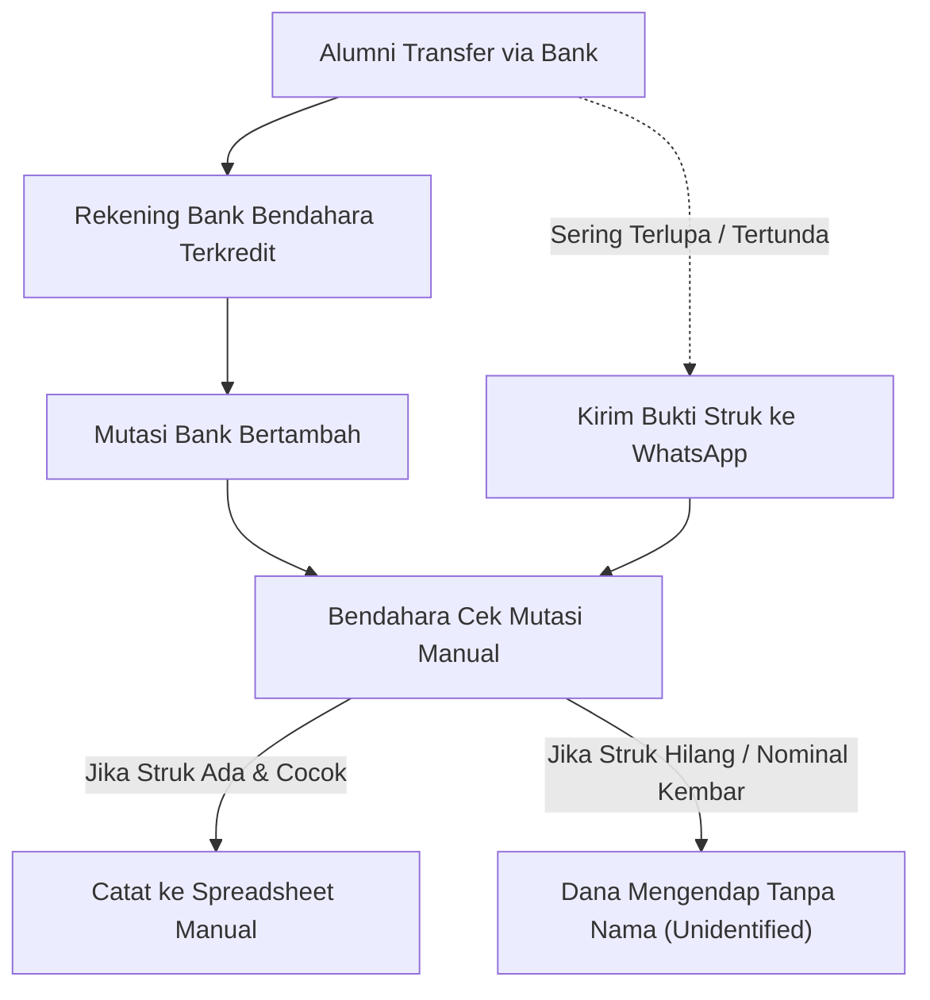
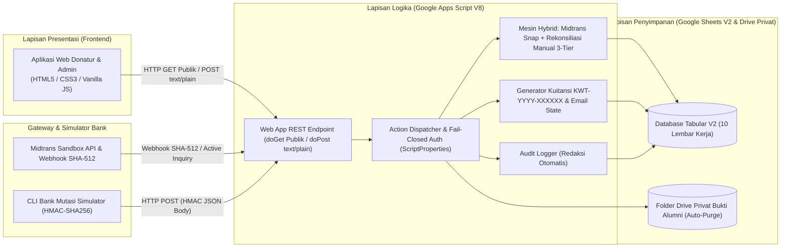
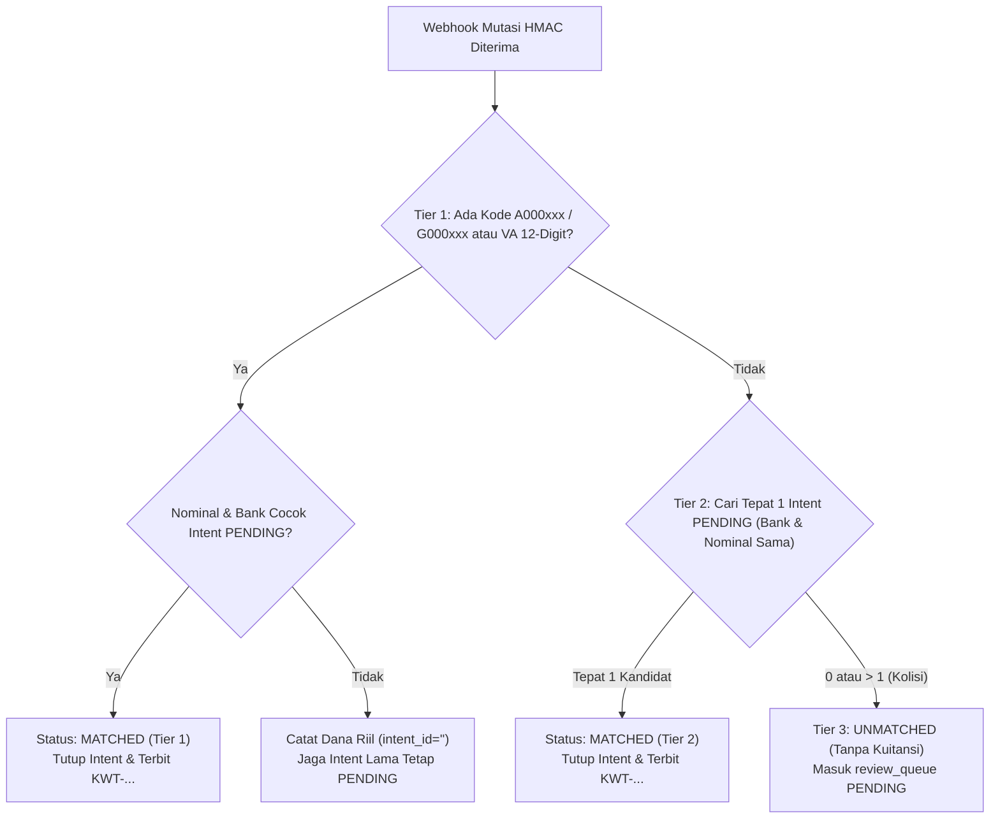

# Laporan Proyek: Sistem Manajemen Donasi Beasiswa Ikatan Alumni UPI Berbasis Rekonsiliasi Otomatis dan Kepatuhan Privasi

**Mata Kuliah:** Data Management  
**Penyusun:** Muhammad Maulana Adrian  
**NIM:** 2408647  
**Program Studi:** Ilmu Komputer, Universitas Pendidikan Indonesia  
**Tahun:** 2026  

---

## 1. Ringkasan Eksekutif

Pengelolaan dana beasiswa alumni pada perguruan tinggi sering menghadapi kendala operasional saat periode penerimaan donasi dibuka. Masalah utama muncul ketika ratusan alumni mentransfer dana secara serentak ke rekening penampung yayasan atau ikatan alumni, tetapi tidak segera mengirimkan bukti transfer melalui kanal pesan singkat. Akibatnya, tim bendahara harus memeriksa riwayat mutasi bank baris demi baris secara manual, mencocokkan nominal yang sama, hingga menghubungi donatur satu per satu untuk memastikan nama pemilik rekening pengirim.

Proyek ini menghadirkan DonasiAlumniApp, sebuah sistem pencatatan donasi terpadu berbasis Google Sheets sebagai penyimpanan data tabular berbiaya nol, Google Apps Script sebagai pelaksana logika bisnis nirserver (serverless API), serta antarmuka web modern yang ringan. Sistem ini memecahkan tiga permasalahan utama:
1. Rekonsiliasi transaksi secara otomatis menggunakan mekanisme pencocokan bertingkat tiga (three-tier matching) dengan bantuan kode referensi unik dan nomor Virtual Account spesifik per bank.
2. Penanganan donatur tidak teridentifikasi secara aman melalui antrean peninjauan manual (unmatched queue) yang dilengkapi penyamaran identitas.
3. Kepatuhan terhadap Undang-Undang Nomor 27 Tahun 2022 tentang Pelindungan Data Pribadi (UU PDP), yang mencakup persetujuan pemrosesan data (consent), penyamaran nama donatur pada papan publik, audit log yang tidak dapat diubah (append-only), serta kebijakan retensi dokumen ijazah.

---

## 2. Latar Belakang dan Masalah

### 2.1 Konteks Pengelolaan Donasi Alumni
Program beasiswa yang dikelola oleh ikatan alumni memegang peranan krusial dalam membantu mahasiswa aktif yang mengalami kendala finansial. Partisipasi alumni umumnya meningkat pesat pada momen tertentu, seperti dies natalis, wisuda, atau awal semester ganjil. Namun, infrastruktur pencatatan donasi pada organisasi nirlaba kampus kerap kali belum terdigitalisasi dengan baik.

Pada sistem konvensional, alumni mentransfer dana ke satu nomor rekening giro atau tabungan atas nama bendahara ikatan alumni. Selanjutnya, donatur diminta mengisi formulir konfirmasi atau mengirim foto bukti transfer ke kontak WhatsApp pengurus.



### 2.2 Titik Kegagalan Operasional (Bottlenecks)
Analisis terhadap proses manual menghasilkan beberapa kelemahan mendasar:
1. **Beban Kognitif dan Human Error:** Bendahara harus menyandingkan layar internet banking dengan tabel spreadsheet secara manual. Kesalahan pengetikan nominal atau tanggal sering terjadi ketika volume transaksi melonjak.
2. **Masalah Nominal Kembar (Collision):** Banyak donatur memilih nominal donasi bulat yang sama, misalnya Rp100.000 atau Rp500.000. Jika dua alumni mentransfer nominal yang persis sama pada hari yang sama tanpa berita transfer, bendahara tidak dapat membedakan kepemilikan dana tersebut.
3. **Penyimpanan Berkas Sensitif Tanpa Batas Waktu:** Pada proses verifikasi status alumni, panitia kerap meminta unggahan foto ijazah atau kartu tanda mahasiswa melalui formulir publik. Berkas ini kerap tertinggal di Google Drive tanpa pembatasan hak akses dan tanpa mekanisme penghapusan berkala, sehingga rentan bocor.
4. **Pelanggaran Kerahasiaan Data Pribadi:** Publikasi daftar donatur di media sosial atau situs web sering kali menampilkan nama lengkap dan nominal donasi secara terang-terangan tanpa meminta persetujuan terlebih dahulu dari donatur bersangkutan.

---

## 3. Dari Prototype Sederhana ke Arsitektur Produksi

Pada awal pengembangan, sebuah purwarupa sederhana dibangun dalam folder `Tugas/DonasiAlumni/`. Purwarupa tersebut membuktikan bahwa formulir HTML dapat mengirimkan data donasi ke Google Sheets melalui Apps Script. Namun, pengujian terhadap purwarupa awal tersebut memperlihatkan keterbatasan arsitektural:
- Belum ada autentikasi pengguna; siapa pun dapat mengubah data jika tautan diketahui.
- Belum ada integrasi webhook bank; pencatatan donasi dan verifikasi uang masuk masih terputus.
- Tidak ada validasi format mutasi bank, sehingga pencatatan mutasi tetap bergantung pada rekap manual.
- Data pribadi, nomor rekening, dan dokumen pendukung tersimpan dalam satu tabel datar tanpa enkripsi atau penyamaran.

Pembelajaran dari purwarupa tersebut melahirkan rancang bangun baru yang menyeluruh, yaitu **DonasiAlumniApp**.

---

## 4. Desain Arsitektur Solusi

### 4.1 Arsitektur Tingkat Tinggi
Sistem DonasiAlumniApp dibangun menggunakan pola arsitektur nirserver (serverless) yang memisahkan lapisan penyajian antarmuka pengguna, lapisan layanan logika bisnis, serta lapisan penyimpanan data tabular.



### 4.2 Skema Kode Referensi Unik, Kuitansi, dan Virtual Account
Untuk mengeliminasi masalah nominal kembar dan memisahkan alumni resmi dengan donatur umum, sistem menerbitkan kode referensi unik tanpa tanda hubung melalui `LockService` pada tabel `counters`:
- **Format Alumni Terverifikasi (`ALUMNI`):** `A000001`..`A000471`, diterbitkan secara atomik hanya setelah pengajuan verifikasi alumni disetujui (`APPROVED`) oleh admin.
- **Format Donatur Tamu (`GUEST`):** `G000001`..`G000012`, diterbitkan tanpa membuat record akun di sheet `users` dan dipasangkan dengan `access_token` acak 256-bit (disimpan ter-hash SHA-256 + `TOKEN_PEPPER`).
- **Format Kuitansi Resmi (`RECEIPT`):** `KWT-YYYY-000001`, diterbitkan eksklusif setelah dana berstatus terkonfirmasi (`MATCHED` / `MANUAL_MATCHED`).

Untuk kanal transfer manual, sistem memetakan kode referensi tersebut menjadi nomor Virtual Account (VA) 12 digit spesifik per bank:
- **Bank Central Asia (BCA):** Awalan `39012` + 1 digit tipe (`1` Alumni, `2` Tamu) + 6 digit nomor urut. Contoh: `390121000471`.
- **Bank Mandiri:** Awalan `89508` + 1 digit tipe + 6 digit nomor urut. Contoh: `895081000471`.
- **Bank Rakyat Indonesia (BRI):** Awalan `88810` + 1 digit tipe + 6 digit nomor urut. Contoh: `888101000471`.
- **Bank Negara Indonesia (BNI):** Awalan `98814` + 1 digit tipe + 6 digit nomor urut. Contoh: `988141000471`.
- **Bank Syariah Indonesia (BSI):** Awalan `90019` + 1 digit tipe + 6 digit nomor urut. Contoh: `900191000471`.

Selain Virtual Account dan QRIS dinamis manual, sistem mendukung jalur **Midtrans Snap Hybrid** (`DON-<REF>-<INTENT>`) dengan sinkronisasi **Dual-Mode** (**Webhook Notification SHA-512** + **Active Status Inquiry** ber-throttle 5 detik pada `check_intent`) serta finalisasi **Self-Healing Write-Ahead** untuk menjamin ketahanan pada penyimpanan Google Sheets non-ACID.

### 4.3 Logika Rekonsiliasi Tiga Tingkat (Three-Tier Matching Engine)
Ketika webhook mutasi bank diterima melalui payload POST JSON berautentikasi HMAC-SHA256 + anti-replay (`timestamp` + `nonce`), mesin rekonsiliasi mengevaluasi tiga lapis berurutan untuk Alumni maupun Guest (via indeks `donation_intents` tanpa memerlukan baris di `users`):



1. **Tier 1 (Pencocokan Pasti melalui Referensi atau VA):** Membaca narasi transfer (`[AG]\d{6}` atau 12-digit VA). Bila cocok `ref_code` + `bank` + `amount` dengan intent `PENDING`, intent ditutup `MATCHED` dan kuitansi `KWT-...` diterbitkan. Jika nominal atau bank berbeda (anti-false-matching), dana riil tetap dicatat `MATCHED` dengan `intent_id = ""` tanpa menutup paksa intent `PENDING` lama.
2. **Tier 2 (Pencocokan Nominal Unik):** Jika tanpa kode referensi, mencari tepat satu intent `PENDING` (Alumni atau Guest) pada bank & nominal yang sama dalam jendela `MATCH_WINDOW_HOURS` (24 jam).
3. **Tier 3 (Antrean Review Queue):** Jika 0 kandidat atau terjadi kolisi nominal (`> 1` kandidat), mutasi dicatat di `transactions` berstatus `UNMATCHED` dengan **`receipt_no` wajib kosong** dan masuk ke `review_queue` untuk ditautkan manual oleh Admin (`MANUAL_MATCHED`, baru diterbitkan `KWT-...`).

### 4.4 Transport CORS Aman & Polling Status Realtime
Seluruh endpoint privat Web App GAS dan frontend `api.js` menggunakan `POST` berheader `Content-Type: text/plain;charset=utf-8` dengan JSON token (`id_token` / `access_token`) di dalam body (nol token pada query string URL) agar lolos *CORS Simple Request* Netlify → Google Apps Script tanpa preflight `OPTIONS`. Antarmuka melakukan polling setiap 5 detik (`check_intent`) hingga status `MATCHED` terdeteksi dan menautkan langsung ke halaman cetak kuitansi resmi `receipt.html` melalui URL `#fragment`.

---

## 5. Model Data dan Skema Lembar Kerja Google Sheets (Skema V2 — 10 Sheet)

Penyimpanan data diimplementasikan pada satu Google Spreadsheet yang telah dimutakhirkan ke **Skema V2 (10 lembar kerja)** secara non-destruktif dan idempoten:

| No | Nama Sheet | Jumlah Kolom | Kunci Utama & Kolom Kunci | Fungsi Utama |
| :--- | :--- | :--- | :--- | :--- |
| 1 | `users` | 9 kolom | `user_id`, `google_sub`, `email`, `full_name`, `role`, `ref_code`, `verification_status`, `consent_at`, `created_at` | Data akun Alumni UPI & Admin (Guest tidak dibuatkan baris di sini) |
| 2 | `alumni_verifications` | 13 kolom | `verif_id`, `user_id`, `email`, `nim`, `grad_year`, `faculty`, `proof_file_id`, `status` (`NOT_SUBMITTED`/`PENDING`/`NEEDS_REVISION`/`APPROVED`/`REJECTED`), `reject_reason` | Tiket pengajuan dan riwayat review ijazah alumni 5-tingkat |
| 3 | `donation_intents` | **21 kolom** | 10 kolom V1 + `is_anonymous`, `payment_channel`, `donor_type`, `donor_name`, `donor_email`, `program_id`, `midtrans_order_id`, `snap_token`, `access_token_hash`, `access_token_expires_at`, `last_inquiry_at` | Niat pembayaran Alumni & Guest (termasuk order Midtrans & hash token 256-bit) |
| 4 | `transactions` | **35 kolom** | 17 kolom V1 + `donor_type`, `donor_email`, `program_id`, `payment_channel`, `gateway_order_id`, `gateway_transaction_id`, `gateway_payment_type`, `gateway_status`, `gross_amount`, `gateway_fee`, `net_amount`, `receipt_no`, `receipt_issued_at`, `access_token_hash`, `access_token_expires_at`, `email_status`, `email_sent_at`, `email_error` | Rekam final transaksi terverifikasi, reversal (`REFUNDED`/`CHARGEBACK`), nomor kuitansi, dan status pengiriman email |
| 5 | `review_queue` | 13 kolom | `queue_id`, `tx_id`, `bank`, `amount`, `description`, `reason`, `candidates_count`, `status`, `assigned_ref_code` | Antrean peninjauan manual admin untuk mutasi Tier 3 (`UNMATCHED`) |
| 6 | `counters` | 2 kolom | `name`, `value` (`ALUMNI`, `GUEST`, `RECEIPT`, `PROGRAM`) | Pengurut atomik berbasis `LockService` |
| 7 | `audit_log` | 5 kolom | `timestamp`, `actor_email`, `action`, `target`, `detail` | Catatan audit append-only dengan redaksi otomatis token & kunci rahasia |
| 8 | `config` | 3 kolom | `key`, `value`, `description` | Konfigurasi non-rahasia (`ALLOW_MOCK_AUTH`, `MIDTRANS_IS_PRODUCTION`, `GUEST_RECEIPT_TTL_DAYS`, dll.; `WEBHOOK_TOKEN` lama dipensiunkan ke `"MIGRATED_TO_SCRIPT_PROPERTIES"`) |
| 9 | `program_keywords` | 2 kolom | `keyword`, `program` | Kamus fallback deteksi program mutasi tanpa intent |
| 10 | `programs` | 6 kolom | `program_id`, `name`, `description`, `is_active`, `created_at`, `updated_at` | Master program donasi terkelola Admin (`PRG-001` s/d `PRG-005`) |

---

## 6. Penerapan Tata Kelola Data dan Kepatuhan Privasi (UU No. 27/2022)

Implementasi DonasiAlumniApp dirancang mematuhi prinsip tata kelola data dan regulasi **Undang-Undang Nomor 27 Tahun 2022 tentang Pelindungan Data Pribadi (UU PDP)**:

### 6.1 Persetujuan Eksplisit (Consent — Pasal 20 UU PDP)
Formulir pendaftaran Alumni (`index.html` / `Users.gs`) maupun checkout Guest (`guest.js` / `Donations.gs`) memaksa pengguna mencentang kotak persetujuan secara sadar (*unchecked by default*) dan memvalidasi `consent === true` di backend sebelum memproses atau menyimpan data.

### 6.2 Penyamaran Identitas 3-Kondisi (`OPEN-02`) & Agregat Publik Murni
Untuk mencegah kebocoran data pribadi maupun serangan *linkage* dari data pseudonymous:
1. Jika donatur memilih opsi **Anonim** (`is_anonymous = 'YES'`), identitas ditampilkan sebagai **`"Seseorang"`**.
2. Jika mutasi bank gagal diparsing sistem (`rawDonorName = ""`), label dicatat terpisah sebagai **`"Pengirim Tidak Tercatat"`**.
3. Jika nama tersedia dan non-anonim, diterapkan masker parsial (`A***d R.`), dan nomor rekening dimasker (`123****890`).
4. Pada endpoint publik (`GET ?action=public_summary`), sistem **tidak mengekspos daftar baris donasi individu** (`recent_donations` dihapus), melainkan hanya **statistik agregat murni** (total dana, total transaksi, perolehan hari ini, serta agregat per program dan per bank) yang di-cache 60 detik.

### 6.3 Retensi Berkas Drive Privat & Minimisasi Data (Pasal 43 UU PDP)
Berkas ijazah alumni diunggah ke folder Google Drive privat tanpa izin berbagi publik (`ANYONE / NONE`) dan hanya dapat ditinjau admin melalui endpoint terautentikasi `admin_verif_proof`. Begitu tiket diputuskan **`APPROVED`** atau **`REJECTED`**, berkas bukti otomatis dihapus (*trashed*) dari Drive, dan keputusan `REJECTED` bersifat **final** (`OPEN-01`) sehingga pengajuan ulang hanya diizinkan lewat status `NEEDS_REVISION`.

### 6.4 Keamanan Kredensial & Otorisasi Berlapis
- Seluruh rahasia sensitif (`GOOGLE_CLIENT_ID`, `ADMIN_EMAILS`, `WEBHOOK_MANUAL_SECRET`, `TOKEN_PEPPER`, `MIDTRANS_SERVER_KEY`) disimpan eksklusif di `PropertiesService.getScriptProperties()` (*fail-closed*).
- Akses kuitansi Guest (`get_receipt`) dan tracker status (`guest_lookup`, `check_intent`) dilindungi oleh token kriptografis 256-bit yang hanya disimpan hash SHA-256 + `TOKEN_PEPPER`, dikirim lewat body `POST` atau URL `#fragment` + `sessionStorage`, serta dilengkapi *rate limiting* `CacheService`.

---

## 7. Implementasi Teknis dan Struktur Berkas

```text
DonasiAlumniApp/
├── apps-script/                         # Backend Google Apps Script V8 (15 file .gs)
│   ├── Setup.gs                         # Skema V1/V2 (10 sheet), backup/restore, staging guard, migrasi & inspeksi
│   ├── Logic.gs                         # Pure logic: VA, parser 5 bank, 3-tier, masker, Midtrans mappers
│   ├── Code.gs                          # Router HTTP doGet (publik) & doPost (text/plain JSON + webhooks)
│   ├── Auth.gs                          # Verifikasi Google ID Token fail-closed, HMAC, ADMIN_EMAILS, 256-bit token
│   ├── Users.gs                         # Registrasi alumni, unggah bukti Drive privat, & review 5-status
│   ├── Programs.gs                      # Master CRUD program donasi + delete guard histori
│   ├── Payments.gs                      # Midtrans Snap client, SHA-512, & alokator nomor KWT-YYYY-000001
│   ├── Receipts.gs                      # Akses kuitansi get_receipt anti-IDOR & proteksi reversal
│   ├── Donations.gs                     # Intent Alumni/Guest, idempotency_proof recovery, & Active Inquiry 5s
│   ├── Webhook.gs                       # Webhook Manual HMAC & Webhook Midtrans SHA-512 Self-Healing
│   ├── Notifier.gs                      # Dispatcher email donatur/revisi/kuitansi & status return {sent, error}
│   ├── Admin.gs                         # Antrean, transaksi filter, sync Midtrans, retry_tx_email, & insights
│   ├── PublicApi.gs                     # Statistik publik agregat murni ter-cache 60 detik
│   ├── AuditLog.gs                      # Append-only log redaksi rahasia & paginasi admin
│   └── Tests.gs                         # Unit self-test internal Apps Script V8
├── frontend/                            # Antarmuka Web Statis (Deploy Netlify)
│   ├── index.html                       # Beranda agregat murni, Google Sign-In Alumni, & Checkout Guest
│   ├── app.html                         # Dasbor alumni & verifikasi 5-status
│   ├── admin.html                       # Portal Admin 6-tab (Verif, Queue, Transaksi/Midtrans, Program, Insight, Audit)
│   ├── receipt.html                     # Portal cetak kuitansi resmi PDF
│   ├── css/style.css                    # Layout editorial UPI & aturan @media print
│   └── js/                              # config.js, api.js, auth.js, guest.js, app.js, admin.js, receipt.js
├── simulator/send_webhook.py            # Simulator mutasi 5 bank berautentikasi HMAC-SHA256
├── tests/                               # Suite uji Node.js (p0..p8 + logic.test.js)
├── PANDUAN_DEPLOY.md                    # Panduan deploy GAS V2, ScriptProperties, Netlify, & QA Live
├── LAPORAN.md                           # Laporan teknis proyek
└── README.md                            # Dokumentasi umum sistem
```

---

## 8. Verifikasi dan Hasil Pengujian Sistem

### 8.1 Ringkasan Pengujian Otomatis Lokal (Node.js GAS V8 Harness — P0 s/d P8)
Seluruh modul domain, keamanan P0, stabilisasi P1, mesin migrasi P2, verifikasi P3, checkout Guest & recovery P4, pembayaran hybrid Midtrans P5, kuitansi P6, dashboard admin P7, dan **20 skenario penerimaan P8** (`TEST-01` s/d `TEST-20`) telah diverifikasi pada simulator runtime lokal dengan hasil **100% lulus (67 Passed, 0 Failed, 0 Skipped)**:

| Suite Pengujian | Cakupan Fase | Hasil |
| :--- | :--- | :--- |
| `tests/logic.test.js` | Pure logic: ref code, VA 12-digit, parser 5 bank, masker `OPEN-02`, 3-Tier | **17 Passed, 0 Failed** |
| `tests/p0_security.test.js` | 8 remediasi keamanan P0 (role hijack, `mock_token`, `aud`, zero query token, RBAC, HMAC) | **9 Passed, 0 Failed** |
| `tests/p1_stabilization.test.js` | Perbaikan `is_anonymous`, program, lookup Guest Tier 1, anti-false-match, `Tests.gs` | **5 Passed, 0 Failed** |
| `tests/p2_migration.test.js` | Backup/verifikasi, `DRY_RUN`, idempotensi 2x, rollback, mandatory Staging Guard, inspeksi 8 invariant | **9 Passed, 0 Failed** |
| `tests/p3_auth_verification.test.js` | State machine 5-level (`OPEN-01`), Drive privat `admin_verif_proof`, kompatibilitas V1 | **5 Passed, 0 Failed** |
| `tests/p4_donation_management.test.js` | CRUD Program, Alumni `APPROVED` gate, Guest `G000xxx`, token 256-bit, `idempotency_proof` & rotasi | **6 Passed, 0 Failed** |
| `tests/p5_midtrans_hybrid.test.js` | Snap token, Webhook SHA-512, 404/Challenge hold, Active Inquiry 5s, Self-Healing, Refund in-place | **5 Passed, 0 Failed** |
| `tests/p6_receipt_notification.test.js` | Eksklusivitas `KWT-`, anti-IDOR `get_receipt`, blokir `UNMATCHED`/`REFUNDED`, `retry_tx_email`, UI cetak | **4 Passed, 0 Failed** |
| `tests/p7_admin_dashboard.test.js` | `PublicApi` agregat murni, `admin_transactions`, `gross`/`fee`/`net`, & `admin_audit_logs` terredaksi | **3 Passed, 0 Failed** |
| `tests/p8_acceptance_20_scenarios.test.js` | 4 kelompok uji terintegrasi mencakup seluruh `TEST-01` s/d `TEST-20` pada `testing_strategy.md` | **4 Passed, 0 Failed** |

### 8.2 Hasil Eksekusi Live Migrasi Skema V2 pada Google Sheets Staging (P2.2)
Selain pengujian VM lokal, migrasi database V1 → V2 telah dieksekusi langsung pada salinan Google Spreadsheet staging **`STAGING_DonasiAlumniApp_P2_2`** dengan hasil terverifikasi:
- `verifyStagingPropsPresence()`: **`PASS`** (seluruh properti wajib `SET`, `allow_mock_auth_is_false: true`).
- `runStagingP2DryRun()`: **`dry_run_ok`** (`mutated: false`, `preflight_ok: true`, `blocking_errors: []`).
- `runStagingP2Migration()`: **`migrated_ok`** (`mutated: true`, backup otomatis `BACKUP_DonasiAlumniApp_P2_V2.0.0_20261118_084312` dengan `verified: true`, dan `integrity.ok: true`).
- `inspectStagingPostMigrationDetails()`: **`8/8 PASS`** (`overall_status: "PASS"` untuk 10 sheet V2, 5 program seed tanpa duplikat, 21 kolom `donation_intents`, 35 kolom `transactions`, 4 counter, unik `receipt_no`, nol kuitansi pada `UNMATCHED`, pensiun `WEBHOOK_TOKEN`, dan `ALLOW_MOCK_AUTH !== "true"`).

### 8.3 Batasan Ruang Lingkup Uji Saat Ini
Pengujian lokal (`67 Passed`) dan inspeksi struktural staging (`8/8 PASS`) membuktikan ketepatan logika, keamanan, dan integritas skema. Pengujian live end-to-end terhadap layanan eksternal Google (`UrlFetchApp`/`tokeninfo`, upload Drive, pengiriman Gmail `MailApp`), CORS Netlify → Web App GAS `/exec`, serta transaksi langsung di **Midtrans Sandbox Simulator** menunggu pengisian kredensial `OPEN-05` (`MIDTRANS_SERVER_KEY` & `MIDTRANS_CLIENT_KEY`) pada tahap QA live.

---

## 9. Keterbatasan Sistem dan Pertimbangan Arsitektural

1. **Ketergantungan Kredensial Midtrans Sandbox (`OPEN-05`) & Mode Sandbox (`OPEN-03`):** Integrasi kode Midtrans Snap dan webhook SHA-512 telah terpasang siap pakai di `Payments.gs` & `Webhook.gs`, namun pengujian pembayaran Sandbox riil memerlukan pengisian kunci Sandbox di `ScriptProperties` dan `config.js`. Selama biaya gateway aktual belum dikembalikan Sandbox (`OPEN-03`), sistem mencatat `gateway_fee = 0` (`gross_amount = net_amount`) disertai label transparan `Mode Sandbox`.
2. **Sifat Non-ACID pada Google Sheets:** `LockService` menserialisasi akses konkuren agar terhindar dari *race condition*, namun Google Sheets tidak mendukung *transaction rollback* seperti RDBMS. Risiko kegagalan parsial diatasi lewat pola **Self-Healing Write-Ahead** pada `recordConfirmedMidtransTransaction_` serta mekanisme backup & restore di `Setup.gs`.
3. **Transport Web App GAS & Keamanan HTTP:** Google Apps Script mengabaikan header HTTP kustom pada `doPost` dan tidak mendukung preflight CORS `OPTIONS`. Sistem mengatasinya dengan menggunakan `Content-Type: text/plain;charset=utf-8` (body JSON untuk token dan HMAC webhook) serta memblokir total autentikasi lewat parameter query URL.
4. **Kuota Harian Eksekusi & Email Google Apps Script:** Akun Google standar dibatasi waktu eksekusi skrip (±6 menit per eksekusi) dan kuota harian `MailApp` (±100 email/hari). Oleh karena itu, status pengiriman email (`SENT` / `FAILED`) diisolasi dari status pelunasan dana dan dilengkapi fitur `retry_tx_email` bagi admin.

---

## 10. Rencana Pengembangan Lanjutan

Untuk meningkatkan kesiapan sistem menuju implementasi skala produksi nyata, beberapa langkah pengembangan lanjutan dirancang sebagai berikut:
1. **Integrasi Payment Gateway Berizin:** Mengintegrasikan SDK resmi payment gateway nasional untuk menerbitkan Virtual Account resmi yang dapat dibayarkan secara nyata oleh seluruh nasabah bank di Indonesia.
2. **Migrasi Penyimpanan Data ke PostgreSQL / Cloud SQL:** Memindahkan tabel transaksi utama dari Google Sheets ke basis data relasional guna menjamin integritas transaksi melalui prinsip ACID (Atomicity, Consistency, Isolation, Durability) dan indeks data yang lebih cepat.
3. **Penerapan Audit Log Berbasis Hash Chain:** Mengembangkan tabel audit log menggunakan algoritma kriptografi rantai blok (cryptographic hash chain) seperti SHA-256, sehingga rekaman riwayat audit memiliki integritas yang terbukti secara matematis dan tahan terhadap potensi manipulasi internal.
4. **Verifikasi Identitas Terpadu (Single Sign-On UPI):** Menghubungkan proses verifikasi alumni dengan pangkalan data akademik resmi Direktorat Sistem Teknologi Informasi Universitas Pendidikan Indonesia melalui protokol OAuth2 atau SAML.

---

## 11. Kesimpulan

Proyek DonasiAlumniApp berhasil mendemonstrasikan bahwa kendala operasional pencatatan donasi alumni, rekonsiliasi mutasi bank yang melelahkan, serta risiko pelanggaran privasi dapat diatasi secara elegan menggunakan teknologi nirserver berbiaya rendah.

Dengan menggabungkan kode referensi unik, Virtual Account 12 digit, mesin rekonsiliasi tiga tingkat, polling antarmuka asinkron 5 detik, serta tata kelola data yang berorientasi pada UU Pelindungan Data Pribadi Nomor 27 Tahun 2022, sistem ini memberikan pengalaman yang nyaman bagi donatur dan efisiensi kerja yang terukur bagi tim pengurus ikatan alumni.

